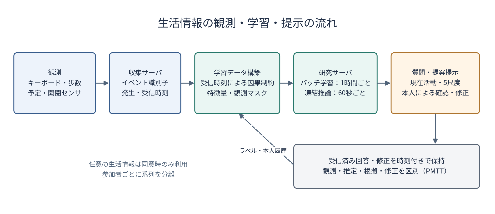

# 第3章 生活情報の観測と学習データ構築

生活状態モデルの入力は、参加者の状態そのものではなく、研究用キーボードや生活情報の取得系を通じて得られる不完全な観測である。操作のない時間、収集が停止した時間、本人が提供を選択しなかった情報を区別しなければ、生活行動の変化と計測条件の変化が混同される。非同期イベントの学習例への変換は、観測単位と利用可能時刻を保ち、取得契約に沿って特徴と教師を分離する手続きである。

## 3.1 観測過程の定義

参加者 $p$ の潜在的な生活状態を $s_p(t)$ とする。情報源 $a$ から得る観測は $o^{(a)}_{p,i}=g_a(s_p(t_i),\eta_{p,i},c_{p,i})$ と表せる。$\eta_{p,i}$ は計測誤差、$c_{p,i}$ は端末の使用状況や取得許可などの観測条件である。観測写像 $g_a$ は情報源ごとに異なるため、入力回数の変化を疲労の変化と直接同一視することはできない。主観状態の教師ラベルも、質問時点と回答状況を伴う別の観測として扱う。

イベントの論理的な記録単位を次式で定める。

$$
e_i=(p_i,a_i,\mathrm{id}_i,t_i^{\mathrm{occ}},t_i^{\mathrm{recv}},v_i,\kappa_i).
$$

$\mathrm{id}_i$ は識別子、$t_i^{\mathrm{occ}}$ は発生時刻、$t_i^{\mathrm{recv}}$ はサーバが受信した時刻、$v_i$ は情報源に応じた値、$\kappa_i$ は同意や仕様の識別に必要なメタデータである。推定時点 $T$ に使用できる集合は、発生と受信の双方が $T$ 以下の記録に限る。収集サーバと研究サーバを分ける構成では、受信時刻を保持したまま複製し、研究サーバ上の処理時刻を元の利用可能時刻に置き換えない。

図3.1　研究用キーボード・歩数・予定・センサの観測を収集サーバへ保存し、受信時刻を保持した学習データ構築を経て研究サーバの学習・推論と質問・提案提示へ接続する構成。

### 3.1.1 観測対象と同意範囲

研究用キーボードの観測対象は、入力・削除・確定などの操作イベントと、それらから導出する操作統計および文章特徴である。歩数などの生活情報、予定情報、開閉センサは任意同意の補助情報源である。取得できる項目の集合を $\mathcal A_p$ とし、参加者ごとの同意集合を固定の全情報源集合から区別する。歩数の提供への同意と運動提案の有効化は独立の設定であり、データ取得の許可から提示への許可を推定しない。

情報源への許可を $c_{p,a}(T)\in\{0,1\}$、許可下での観測の存在を $r_{p,a}(T)\in\{0,1\}$ とすれば、観測可能性は $m_{p,a}(T)=c_{p,a}(T)r_{p,a}(T)$ で表される。ただし、モデル入力のpresence値だけでは未同意と通信失敗の原因を識別できない。原因の区別には設定・収集状態の記録を併用する。原文を含む情報を取得する経路と、数値特徴を推定へ渡す経路も区別する。文章特徴のローカル生成は原文の外部送信を避ける設計であるが、特徴ベクトルだけで匿名性が保証されるという意味ではない。

### 3.1.2 時刻と系列の単位

時刻にはタイムゾーンを要求し、系列構築では日本標準時へ統一する。日境界は同時間帯の午前0時、週境界は月曜日の午前0時である。現在状態の回答では、質問が提示された対象時刻 $t^{\mathrm{target}}$、端末上の回答完了時刻 $t^{\mathrm{ans}}$、サーバ受信時刻 $t^{\mathrm{recv}}$ を分ける。学習に利用できる時刻は少なくとも受信時刻以後であり、回答完了が早くても未受信の回答は過去予測に使用しない。

現行の三階層入力は5分幅のMicroビン、最大1時間の作業区間、日、現在の週を基本単位とする。確認済み活動の変化や修正区間の境界があれば、1時間の中でも作業区間を分割する。Micro系列は区間内の5分ビン列、Meso系列は日内の作業区間列、Macro系列は当週の日表現と先行28日の日別観測から構成される。参加者をまたぐ系列連結は行わず、合成サンプルも実参加者とは別の識別子とデータモードで管理する。

## 3.2 キーボード由来の観測変数

キーボードには、生活行動の間に現れる端末操作を継続的に捉える役割がある。ただし、研究用キーボード以外の入力や入力しない活動まで網羅するわけではない。したがって、操作統計に加えて、セッションの存在、最終観測からの経過時間、heartbeat、収集有効状態を特徴として保持する。文章特徴は確定イベントから得る範囲に限定し、自己報告の回答文を観測特徴に混入させない。

### 3.2.1 打鍵系列の表現

区間 $B=(u,v]$ に含まれ、推定時点 $T$ までに受信された打鍵時刻を $\tau_1<\cdots<\tau_n$ とする。打鍵数、削除数、確定文字数には $\log(1+x)$ を適用し、大きな計数値の尺度を圧縮する。隣接間隔 $\delta_j=\tau_j-\tau_{j-1}$ から次式の統計を得る。

$$
\bar\delta_B=\frac{1}{n-1}\sum_{j=2}^{n}\delta_j,\qquad
\delta_B^{\max}=\max_{2\le j\le n}\delta_j,\qquad
N_B^{\mathrm{pause}}=\sum_{j=2}^{n}\mathbf1[\delta_j>2\ \text{秒}].
$$

平均・最大間隔は分単位へ変換し、休止回数には対数変換を行う。$n<2$ の場合、間隔統計は未観測とし、ゼロ秒の間隔を作らない。セッション、打鍵または5分以内の収集中heartbeatによって観測範囲が確認できれば、打鍵ゼロを観測された無操作として表せる。この根拠がない区間では、打鍵数の値領域をゼロで埋めても対応マスクをゼロとする。

「普段との差」を検出する `typing_change` は、LSTMの5分特徴とは別に固定10分窓を使用する。物理的な挿入経路である `kana`・`text_insert` と本人の削除だけを採用し、navigationを含む一般的な `key` は挿入数とみなさない。合成操作と質問回答の操作も除外する。連続削除を2秒以内の訂正バーストへまとめ、窓内の訂正率をバースト数／挿入数とする。

端末・入力モードごとに窓を日単位でプールし、日 $d$ の挿入数 $I_d$ と訂正バースト数 $B_d$ から $R_d=B_d/I_d$ を得る。有効日は $I_d\ge50$ の日である。過去の有効日が3日以上5日未満なら暫定、5日以上なら正式とし、閾値を $\theta=\max\{Q_{0.99}(\{R_d\}_{d<d_0}),0.02\}$ と定める。現行判定は当日の率と直前有効日の率がともに $\theta$ を上回ることを要求する。これは誤入力の確定ではなく、訂正操作が通常より多いことを示す根拠である。

### 3.2.2 文章特徴の表現

文章特徴の対象は各窓の確定イベントから構成する文字列である。確定候補の置換が観測済み接尾部に対応する場合、その接尾部を除いて新しい確定内容を加える。窓より前の文章を文書全体として復元する処理ではない。入力前後のcontext文字列は重複する履歴を生じ得るため、文章特徴に含めない。各入力は末尾4096文字以内へ制限する。その後、採用モデルのtokenizerにより最大128トークンへ切り詰めるため、4096文字すべての意味を必ず保持するわけではない。

LocalEncoderでは、次のSentenceTransformerをローカルディレクトリに配置し、凍結して使用する。

- モデル：`sentence-transformers/paraphrase-multilingual-MiniLM-L12-v2`
- revision：`e8f8c211226b894fcb81acc59f3b34ba3efd5f42`

文章埋め込みの基礎となるSentence-BERTの表現学習は、文単位の類似性を扱うために設計されたものである[@reimers2019sentencebert]。使用構成の埋め込みは384次元であり、固定ランダム射影により32次元へ変換する。$E(w)\in\mathbb R^{384}$ を正規化済み埋め込み、$R\in\mathbb R^{384\times32}$ を固定行列とすれば、

$$
e(w)=\frac{E(w)R}{\max(\|E(w)R\|_2,10^{-8})},\qquad
R_{jk}\sim\mathcal N(0,1/32)
$$

である。射影乱数のseedは17で固定し、エンコーダのファイル内容に基づく識別情報を学習記録へ残す。実装はモデルの埋め込み次元を取得して射影行列を作るため、384次元は使用モデルの構成であり、任意モデルに強制する定数ではない。

モデルは `local_files_only=True` で読み込み、推定中に原文を外部サービスへ送信しない。学習CLIの既定値とサーバー設定例は同じローカルモデルを指定する。モデル未配置時はエラーとし、別方式へ自動で切り替えない。比較用に `--character-ngram` を指定した場合、または互換用APIで `text_model=None` とした場合は、文字1・2・3-gramの符号付きハッシュによる32次元ベクトルを用いる。この経路もローカル処理であるが、事前学習言語モデルによる埋め込みとは区別して評価する。基本学習、文脈学習、SSL・部分プーリングの実験で同じモデルを渡し、SSL用に自己報告を取り除く際もエンコーダを保持する。モデルID・revision・内容ハッシュ・射影seedを学習記録に残し、文字n-gramの既存重みは再学習してから使用する。ここでの導入は実装構成を表し、参加者データでの性能向上を示す結果ではない。空文字列は零ベクトルとし、文字数と観測範囲を併せて解釈する。

## 3.3 任意同意の生活情報

生活情報は操作だけでは識別しにくい活動の背景を補う。歩数が増えたという観測は移動の候補根拠になるが、その目的や本人の集中状態を確定しない。同様に、予定があることと実際に参加していること、開閉状態と本人の在室は一致するとは限らない。入力へ変換する際は値だけでなく計測時刻と鮮度を持たせ、情報源の意味を超えるラベルを生成しない。

### 3.3.1 歩数と予定情報

歩数スナップショットを $P_i$ とすると、同一参加者・端末・日の連続観測の差分を $\Delta P_i=\max(0,P_i-P_{i-1})$ とする。状態内歩数の集計では、前観測がない場合、累積値が減少した場合、観測間隔が900秒を超えた場合を除外し、長い欠落中の歩数を後側の状態へ誤帰属させない。日をまたぐリセットも差分に混ぜない。集計と提案にはこの差分を用いるが、現行の98次元LSTM特徴の `steps` は新鮮な日累積値の $\log(1+P_i)$ である。区間増分と累積値を同一視しない。

歩数に加え、取得可能な歩行距離、階段、活動エネルギー、歩行速度、歩幅、左右非対称性を扱う。最新セッションのcontextと項目ごとの更新時刻を確認し、入力特徴では2時間以内の有限な値を利用する。運動提案用の歩数保存では別途15分以内の鮮度を要求するため、学習特徴の鮮度判定と同じ基準ではない。

予定情報は取得可能なカレンダー記録から、推定時刻が予定区間に入るかを示す `calendar_busy` と、記録された予定数の対数値 `calendar_count` に変換する。開始・終了が $a_j,b_j$ の予定集合 $\mathcal C$ に対し、$c_{\rm busy}(T)=\mathbf1[\exists j:a_j\le T<b_j]$ である。現行の特徴生成は予定タイトルの文章埋め込みを98次元へ追加しない。タイトルを含む取得契約と、推定で実際に使う予定の在否・件数を区別する。予定がないことも、鮮度と取得可否が確認された場合に限り観測値となる。

### 3.3.2 開閉センサ状態

開閉センサは玄関・寝室に対応する状態と経過時間を入力へ与える。推定時点までに利用できる最後の観測を $j^\ast$ とすると、$q(T)=q_{j^\ast}$ は観測状態の復元値である。長時間の状態保持には周期的なBLE観測が必要となる。特徴生成は変化イベントと周期観測の両種を受け入れ、最終観測から120秒以内の場合に状態を有効とする。

状態 `close` を0、`open` および `timeOutNotClose` を1へ変換する。未知状態または鮮度不足はpresenceを0とし、最終観測の経過時間を別座標に保持する。センサ名に基づく玄関・寝室の対応は計測箇所の識別であり、本人の居場所の教師ラベルではない。

場所・タスクの推定には別のContextLSTMを使用する。隠れ次元は24、場所とタスクの埋め込みはそれぞれ32次元であり、両者の本人確認ラベルを独立に扱う。GPS、Wi-Fi識別子、RSSI、既存の場所訪問イベントをその観測入力に使用しない。場所とタスクを同一の分類として結合せず、未知状態を回答による確認が済んだ状態へ勝手に置き換えない。

## 3.4 教師ラベルの定義

教師ラベルは本人による活動回答、現在の5尺度、日次振り返りの5尺度である。質問回答を観測センサの一部として再入力すると、推定対象が入力に混入する。質問用操作は通常の打鍵特徴から除き、回答は教師、過去履歴統計、受信済み活動境界の構成に使用する。回答した尺度値を同じ時点の数値観測特徴へ直接入力しない。本人回答と後日の修正は識別子を保持した別記録として追加する。

### 3.4.1 活動ラベルと5尺度

現在活動は、デスクワーク、会議・打合せ、勉強・研究、料理、掃除、洗濯、買い物、食事、入浴、トイレ、身支度、くつろぎ、仮眠、就寝準備、テレビ・動画、ゲーム、読書、スマホ・SNS、散歩、通勤・通学、用事、家族と、友人と、通話の24カテゴリである。カテゴリIDは順序を持たず、未確認活動は別の欠測値として扱う。活動名に含まれる日常語から、場所や主観尺度の値を自動的に推定して教師へ追加しない。

尺度の順序を気分・疲労・ストレス・集中度・眠気と固定し、$\boldsymbol y=(y_1,\ldots,y_5)$、$y_k\in\{1,2,3,4,5\}$ とする。数字が大きいことの意味は尺度ごとに異なり、全尺度を「状態が悪い」方向へ統合しない。現在と日次は異なるscopeを持つ教師である。部分回答の有効性を次式で表す。

$$
m_k^y=\mathbf1[y_k\text{ が数値であり }1\le y_k\le5],\qquad
\tilde y_k=
\begin{cases}y_k&m_k^y=1,\\3&m_k^y=0.\end{cases}
$$

補完値3は損失計算の配列を保つための値であり、有効性マスクが0の尺度には教師として用いない。実装は範囲内の有限な数値を受け入れるため、入力検証と質問画面の5段階選択を分けて記録する。全尺度が無効な回答は尺度学習例に加えない。

### 3.4.2 回答対象時刻と取得遅延

現在状態と活動確認の入力カットオフは質問提示時刻を優先し、記録がない場合は検出時刻を用いる。回答完了までに起きた操作やセンサ変化を、質問時点の予測特徴へ遡って加えない。質問対象時刻が受信可能時刻より未来である不整合な回答は利用しない。自由記述として送られる尺度回答は構造化された数値へ検証し、解釈できない内容は教師に変換しない。

回答の取得遅延を $\Delta_i=t_i^{\mathrm{available}}-t_i^{\mathrm{target}}\ge0$ と定める。修正では指定区間の終端を対象時刻、受信を含む時刻を利用可能時刻とする。予測時点 $T$ の履歴条件付けに使用する集合は次式である。

$$
\mathcal Y_p(T)=\{i:p_i=p,\ t_i^{\mathrm{target}}<T,\ t_i^{\mathrm{available}}<T\}.
$$

この二重条件により、過去を対象とする遅延回答も受信前には使用されない。活動参照は受信時刻 $T$ 以下の修正区間を優先し、それがなければ対象時刻から30分以内の受信済み活動回答を用いる。履歴平均の厳密不等号とは別の規則である。参照できなければ活動不明とする。受信履歴のない旧形式記録の代替時刻は、厳密な受信時刻評価と区別する。

## 3.5 学習系列の構築アルゴリズム

変換処理は、参加者とデータモードを選択し、記録の重複を除き、時刻を整列し、推定時点での利用可能性を判定した後、観測特徴と教師を別々に構築する。日や週の全データを先に集約してから過去時点を切り出すと、未受信情報が既に集約値へ入る危険がある。したがって各学習例は対象時刻を持つ仕様として保持し、そのカットオフに従って具体的なテンソルを生成する。

### 3.5.1 時間整列と階層別集約

入力は33種類の基礎量 $\boldsymbol v$、対応する33個のpresence $\boldsymbol m$、32次元の文章特徴 $\boldsymbol e$ の連結である。

$$
\boldsymbol x=[\boldsymbol v;\boldsymbol m;\boldsymbol e]\in\mathbb R^{98}.
$$

33基礎量は、操作・取得状態10、玄関・寝室4、健康・歩行8、予定・端末context5、時刻・区間長・文字数6からなる。時刻は時刻帯と曜日の正弦・余弦で周期性を表し、区間長は5分を基準に数値化する。個人履歴40次元は別の `personal` 入力であり、この98次元に含まれない。

推定時点 $T$ の属する週の開始を $W(T)$ とする。$W(T)$ から $T$ までを日別に分け、各日を正時と受信済みの活動・修正境界で分割する。各区間を5分ビンへ分け、終端の短いビンも実際の長さで特徴化する。テンソルは日数7、日内区間上限48、区間内ビン上限12を持つ。実系列長 `lengths`・`units`・`days` を別に保持し、未使用領域をpaddingとする。区間数が上限を超えた場合は例外とし、末尾の観測を黙って切り捨てない。

Microの最終hiddenを区間要約、日内の区間要約を入力するMesoの最終hiddenを日要約とする。Macroの履歴入力は、当週より前の28日分の日別観測特徴である。実装の各窓は $(W(T)-(i+1)\text{日},W(T)-i\text{日}]$、$i=27,\ldots,0$ であり、受信時刻は $T$ 以下に限る。右閉窓のため週境界ちょうどのイベントは最後の履歴窓へ入る。履歴を全結合層で変換し、当週の日要約列へ時間方向に連結する。先行28日は保存済みhiddenではない。観測のない日もマスク付きで固定窓を構成する。

### 3.5.2 欠測・未同意・無操作の符号化

基礎量 $v_j$ がない場合は値領域を0、presenceを0とする。観測されたゼロは値0、presence1であり、同じ数値でも意味が異なる。無操作は取得範囲を確認できる場合の打鍵数ゼロであり、未同意と欠測は入力上の未観測に加え、取得設定と鮮度で原因を識別する。文章ブロックには32個の独立したpresence座標を追加せず、文字数、操作範囲およびブロックの零ベクトルを併用する。

学習区間の観測値だけから平均 $\mu_j$ と標準偏差 $\sigma_j$ を計算し、$\sigma_j$ の下限を0.1とする。正規化は33基礎量に限り、

$$
x_j^{\mathrm{norm}}=m_j\frac{v_j-\mu_j}{\max(\sigma_j,0.1)}
$$

とする。presenceと文章特徴はそのまま保持し、paddingのビンは全座標を0とする。欠測を平均値で観測したかのように学習しないため、正規化後にもマスクを掛ける。活動や尺度の欠測マスクは入力の観測マスクとは別であり、センサが欠けたことから教師の有効性まで消去しない。

### 3.5.3 データ取得手段と保存形式

収集側の保存単位は参加者、kind、イベントID、時刻、JSON payload、単調な保存順序番号である。保存契約は参加者・kind・IDの組に一意性を持たせ、再送された同一記録を二重保存しない。受信時刻はサーバ側で付与し、発生時刻による並び替えには保存順序を補助キーとして用いる。セッション内操作もセッション識別子と位置により区別する。複製時は保存順序の上限でsnapshotを固定し、処理途中に増えた記録による対象集合の変動を避ける。

重複排除、イベント時刻の整列、受信時刻の因果判定はイベントログ正規化である。LSTMのhidden・cell状態を保存する処理とは別の責務であり、遅延記録を受信したことだけで過去の状態や評価予測を上書きしない。現行学習例は固定されたTimelineから遅延生成して一度具体化し、同じ実行内の学習・検証で再利用する。

本番推論は60秒間隔で凍結モデルを用い、再学習は1時間ごとにデータ指紋と構成の変化を確認してバッチで行う。候補と現行モデルを同じ時系列検証集合で比較し、候補の現在・日次尺度の有効MAE平均が現行以下なら昇格させる。同点も新規候補を採用し、評価区間の成績は昇格に用いない。指紋、特徴仕様、正規化、文章エンコーダ識別情報、分割境界をモデルとともに保持する。状態保持とTBPTTは第4章で定義する検証設計であり、この運用に逐次的な重み更新や階層状態の持越しが実装済みであるとはみなさない。
