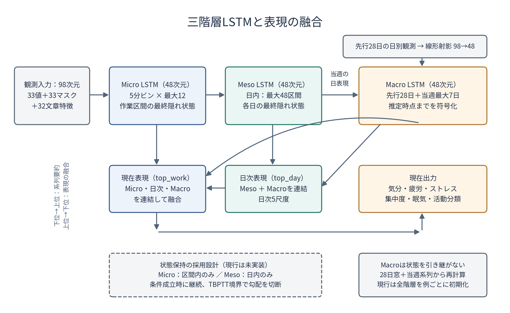

# 第4章 共有三階層LSTMによる生活パターン発見と状態推定

同じ「勉強・研究」という活動名でも、文章を書く時間と実験装置を操作する時間では、観測される入力行動や生活情報が異なる。一方、場所が変わっただけで同じ作業を別の行動とみなすことも適切ではない。固定カテゴリによる活動分類と、個人固有のタスク推定を並行して行うと、何を別の状態として識別するかが二重に定義される。

本研究の提案構成では、活動の意味カテゴリをあらかじめ24個に固定せず、共有の時系列表現から拠点と行動パターンを扱う。現在・日次の5尺度も同じエンコーダから推定する。行動候補の発見、本人による同一性の確認、名前の付与は別の操作である。特徴が似た観測のまとまりが得られても、そのまとまりを直ちに「修論執筆」などの意味へ置き換えない。

対応する実装は`life-discovery-v1`である。24クラス分類を含む従来のHierarchicalLSTMと、独立したContextLSTMは比較条件として保持するが、提案構成と同時に二重の行動推定を行うものではない。実参加者における有効性は第5章の評価課題であり、実装や合成テストの存在だけから改善を主張しない。

## 4.1 推定対象と観測情報

参加者$p$について、イベント発生時刻と受信時刻の双方が推定時刻$t$以下である観測の集合を$\mathcal H_p^{\rm obs}(t)$とする。入力$x_{p,d,u,k}\in\mathbb R^{98}$は、33個の観測値、対応する33個の存在指示、32次元の文章特徴からなる。$d$は日、$u$は日内区間、$k$は区間内ビンを表す。観測値の欠測と実測ゼロを区別し、文章特徴はローカルで生成する。

本人の活動回答、拠点・行動確認、モデル推定を観測特徴にしない。24活動の回答は入力区間の境界にも用いない。入力系列を構成するTimelineには観測記録だけを渡し、質問の回答内容を変えただけで同じ観測系列の表現が変わることを防ぐ。

数式中の入力$x$は前処理後の特徴とする。33観測値の平均と標準偏差は訓練側の観測済み座標だけから求め、標準化後も欠測座標を存在指示でゼロ化する。存在指示と文章32座標は標準化しない。文章特徴はローカルSentenceTransformerで生成した文埋め込みを固定ランダム射影したものであり、エンコーダの同一性をcheckpointと照合する。文エンコーダの導入・比較条件は§3.2.2に示す。

共有エンコーダの出力を現在表現$C_p(t)\in\mathbb R^{48}$と日次表現$D_p(t)\in\mathbb R^{48}$とし、推定対象を次式で表す。

$$
\left(z_p^{P}(t),z_p^{B}(t),\hat y_p^{\rm cur}(t),\hat y_p^{\rm day}(t)\right)
=f_\theta\left(\mathcal H_p^{\rm obs}(t)\right).
$$

$z^P,z^B\in\mathbb R^{32}$はそれぞれPlaceとBehaviorの表現であり、32種類の場所・行動を意味しない。5尺度の順序は気分、疲労、ストレス、集中度、眠気に固定する。尺度は本人回答に対応する研究上の推定対象であり、診断や客観的な心理状態の測定ではない。

Placeは本人が区別する生活拠点、Behaviorは本人固有の行動パターンである。同一場所の別作業と、別場所の同じ作業を独立に確認できるよう、両軸のIDを分離する。既存APIの`task`および`taskCheck`はBehaviorの互換名として維持し、第三の推定対象は作らない。

## 4.2 三階層の時間表現

各階層には隠れ次元48の単方向LSTMを一つずつ用いる。LSTMの基本更新はゲートを介したセルの保持と更新である[@hochreiter1997lstm]。本実装で用いる忘却ゲートはLSTMの後の発展に対応する[@gers2000forget]。入力$v_j$、前隠れ状態$h_{j-1}$、前セル状態$c_{j-1}$について、

$$
\begin{aligned}
i_j&=\sigma(W_iv_j+U_ih_{j-1}+b_i),&
f_j&=\sigma(W_fv_j+U_fh_{j-1}+b_f),\\
o_j&=\sigma(W_ov_j+U_oh_{j-1}+b_o),&
g_j&=\tanh(W_gv_j+U_gh_{j-1}+b_g),\\
c_j&=f_j\odot c_{j-1}+i_j\odot g_j,&
h_j&=o_j\odot\tanh(c_j)
\end{aligned}
$$

とする。$\sigma$はシグモイド関数、$\odot$は要素積である。実装の入力側・再帰側バイアスは式の$b$へ合算して表す。重みは階層別に持ち、PlaceとBehaviorごとに別の三階層を作るものではない。入力ゲートは候補情報の書込み、忘却ゲートは過去セルの保持、出力ゲートは隠れ状態への読出しを制御する。これらのゲートは学習されるため、時間尺度ごとの固定平滑化係数ではない。セルの加法的経路は記憶の保持を助けるが、長期依存を常に学習できることを保証しない。

### 4.2.1 MicroとMeso

Microは正時境界で区切った最大1時間を、最大12個の5分ビンとして処理する。末尾の短いビンは実際の長さで構成し、推定時刻より後の観測を含めない。区間の最終隠れ状態を$w_{d,u}$とする。

$$
w_{d,u}=\operatorname{LastHidden}\left(\operatorname{LSTM}_{\mu}(x_{d,u,1:K_{d,u}})\right).
$$

Mesoはその日の区間表現を時間順に処理し、日表現$q_d$を得る。

$$
q_d=\operatorname{LastHidden}\left(\operatorname{LSTM}_{m}(w_{d,1:U_d})\right).
$$

保存テンソルは一日48区間を上限とし、有効長を別に保持する。提案構成では活動回答による追加分割を行わない。過去日はその日の終端まで、当日は推定時刻までの観測を使う。過去日の観測でも、受信が推定時刻に間に合っていることを要求する。

実装は有効長の系列をパックし、パディングを無操作の実測ビンとしてLSTMへ与えない。長さゼロの保存区間の表現はゼロとする。ちょうど日付が変わった時点には空の部分ビンを一つ設け、有効長を扱えるようにする。推定時刻が区間途中であれば、その時点までの部分系列の最終状態を使うため、区間終了後の情報を待ってから現在予測を行う構成ではない。

### 4.2.2 Macroと融合

当週は日本標準時の月曜日開始とする。当週開始前に対応する28個の日別観測特徴$r_i\in\mathbb R^{98}$を古い順に線形射影し、当週の日表現列へ時間方向に連結する。過去28日は保存されたMesoの隠れ状態ではなく、日別観測を再集約した特徴である。当週開始を$W$とすると、履歴窓は$(W-(i+1)\mathrm{日},W-i\mathrm{日}]$、$i=27,\ldots,0$である。下式の$r_1$は$i=27$の最古窓、$r_{28}$は$i=0$の最新窓に対応する。右閉区間であるため、$W$ちょうどのイベントは最後の履歴窓に含まれる。受信締切はいずれの窓でも推定時刻$t$である。

$$
H=\operatorname{LastHidden}\left(\operatorname{LSTM}_{M}
\left([W_Hr_1+b_H,\ldots,W_Hr_{28}+b_H,q_1,\ldots,q_{d_*}]\right)\right).
$$

日次表現$D$と現在表現$C$は次式で得る。

$$
D=\tanh(W_D[q_{d_*};H]+b_D),\qquad
C=\tanh(W_C[w_{d_*,u_*};D;H]+b_C).
$$

上位の文脈は出力前の融合へ用い、Microのセルへ直接注入しない。$[\cdot;\cdot]$は特徴方向の連結であり、Macro式中の列は時間方向の連結である。実装の`top_day`が$D$、`top_work`が$C$に対応する。現行実装は各系列を初期状態から再計算する。推論間のhidden/cell持越しや、本番のTBPTTによる逐次重み更新は含まない。

## 4.3 拠点・行動・主観尺度の出力

PlaceとBehaviorは共通の現在表現から別の射影を通して得る。$\operatorname{norm}(v)=v/\max(\lVert v\rVert_2,\epsilon)$、$\epsilon=10^{-12}$とすれば、

$$
z^P=\operatorname{norm}\{\tanh(W_PC+b_P)\},\qquad
z^B=\operatorname{norm}\{\tanh(W_BC+b_B)\}.
$$

現在・日次の尺度は別の出力層で推定する。

$$
\hat y^{\rm cur}=1+4\sigma(W_{\rm cur}C+b_{\rm cur}),\qquad
\hat y^{\rm day}=1+4\sigma(W_{\rm day}D+b_{\rm day}).
$$

5尺度の予測値を行動クラスタリングの距離へ連結しない。この構成は、出力得点の変化だけによって直接別の行動ノードへ割り当てることを避ける。ただしエンコーダは共有されるため、行動表現から心理状態の影響が完全に除去されるわけではない。

同様に、射影を二つ設けるだけでは場所と行動の意味は分離されない。自宅でしか行わない作業は、自宅を示す観測と共起し続ける。両者を区別するための情報は、異なる場所で同じ行動を行った観測、同じ場所で別行動を行った観測、および独立した本人確認である。観測上区別できない状態は不明のまま残す。

## 4.4 自己教師あり学習と本人確認の併用

学習は自己教師あり損失と本人回答の損失を同時に最適化する。別段階の事前学習を必須とする構成ではない。教師がない観測からも表現を学習するが、無回答を架空の正解として補わない。

### 4.4.1 マスク再構成と将来予測

最新ビンの観測済み特徴を確率0.2で選び、値と対応するpresenceを隠す。文章は32座標全体を一つのブロックとして隠す。時間周期、区間長、heartbeat鮮度、収集設定は再構成対象から除外する。マスク後の現在表現から元の特徴を再構成し、選択された有効座標集合$\mathcal M$だけに損失を適用する。

文章ブロック自体の選択確率も0.2であり、32座標を独立に抽選してからブロックへ拡張する旧SSLの方式とは異なる。文章を隠すときは`text_chars`の値と存在指示も消す。存在指示そのものは再構成の正解にはしない。非マスク入力の出力を将来予測・関係・尺度・分散損失に用い、再構成だけにはマスク入力からの別の順伝播を用いる。マスク後の現在表現を$C^{\rm mask}$とすると、再構成ヘッドは$\hat x=W_{\rm rec}C^{\rm mask}+b_{\rm rec}$である。

$$
\mathcal L_{\rm rec}=\frac{\sum_{(i,j)\in\mathcal M}(\hat x_{i,j}-x_{i,j})^2}{\max(1,|\mathcal M|)}.
$$

ここで$i$はバッチ内の例、$j$は特徴座標であり、$\mathcal M$は選択された観測済み有限値の組である。再構成の正解は標準化後の元の最新ビンである。将来予測は$[z^P;z^B]$から次の1時間$(t,t+1\mathrm{時間}]$の観測特徴を推定する。生特徴を訓練側統計で変換した教師を$\tilde x^+$、有効性を$m_{i,j}^+$として、

$$
\hat x_i^+=W_+[z_i^P;z_i^B]+b_+,\qquad
\mathcal L_{\rm future}=\frac{\sum_{i,j}m_{i,j}^+(\hat x_{i,j}^+-\tilde x_{i,j}^+)^2}{\max(1,\sum_{i,j}m_{i,j}^+)}
$$

とする。マスクは再構成と同じ観測座標の定義を用い、有限値だけを選ぶ。各損失は例ごとの平均をさらに平均するのではなく、バッチ全体の有効座標で平均する。予測対象の1時間の終端が分割の締切以上、またはデータ取得締切より後である場合は、そのターゲットを使わない。将来特徴はその終端までに受信された観測から作る教師であり、現在入力へ渡すものではない。

### 4.4.2 本人確認による関係学習

軸$a\in\{P,B\}$ごとに、本人が確認したIDを双方が持つバッチ内のペア集合$\mathcal P_a=\{(i,j):j<i,\ k_i^a,k_j^a\text{が有効}\}$を作る。同一IDの表現は近づけ、異なるIDはコサイン類似度が0.3を超える場合に離す。

$$
\ell_a(i,j)=
\begin{cases}
1-(z_i^a)^\top z_j^a,& k_i^a=k_j^a,\\
\max\{0,(z_i^a)^\top z_j^a-0.3\},& k_i^a\ne k_j^a,
\end{cases}
\qquad
\mathcal L_{\rm rel}^{a}=\frac{\sum_{(i,j)\in\mathcal P_a}\ell_a(i,j)}{\max(1,|\mathcal P_a|)}.
$$

Placeの正解をTaskの違いから生成することも、その逆も行わない。未確認、わからない、移動中には同一性ラベルを作らない。命名だけの操作も同一性の教師を追加しない。

### 4.4.3 尺度損失と全体損失

現在・日次の尺度には回答済み有限値の座標だけのHuber損失を用いる[@huber1964robust]。$s\in\{\mathrm{cur},\mathrm{day}\}$、有効な例と尺度の組を$\mathcal O_s$として、

$$
\mathcal L_s=\frac{\sum_{(i,j)\in\mathcal O_s}\rho_1(\hat y_{i,j}^{s}-y_{i,j}^{s})}{\max(1,|\mathcal O_s|)},\qquad
\rho_1(r)=\begin{cases}\tfrac12r^2,&|r|<1,\\|r|-\tfrac12,&|r|\ge1.\end{cases}
$$

埋め込みが単一の値へ縮退することを抑えるため、各軸にバッチ内分散のペナルティも加える。

$$
\mathcal L_{\rm var}^{a}=\frac1{32}\sum_{j=1}^{32}
\max\{0,0.05-\sqrt{\operatorname{Var}_{\rm batch}(z_j^a)+10^{-4}}\}.
$$

$\operatorname{Var}_{\rm batch}$はバッチ件数で除した分散であり、不偏分散ではない。バッチが一例の場合、分散項はゼロとする。回答のない尺度損失と有効ペアのない関係損失もゼロとし、欠測を架空の教師に置き換えない。尺度損失は現在・日次ごとに有効座標で平均するため、一方の回答数の多さだけで他方を希釈しない。全体は次式である。

$$
\mathcal L=\mathcal L_{\rm rec}+\mathcal L_{\rm future}
+\mathcal L_{\rm cur}+\mathcal L_{\rm day}
+0.1\sum_{a\in\{P,B\}}\mathcal L_{\rm rel}^{a}
+0.1\sum_{a\in\{P,B\}}\mathcal L_{\rm var}^{a}.
$$

24クラスの交差エントロピーは含めない。分散項や関係損失は表現の制約であり、意味の分離を保証する定理ではない。既定の最適化はAdamW[@loshchilov2019adamw]、学習率0.001、weight decay0.001、バッチ8、12エポック、乱数seed37、勾配ノルム上限1である。AdamWのweight decayは損失への単純なL2項の加算と区別する。観測例は各エポックでシャッフルし、LSTMの状態は例間で引き継がない。

## 4.5 カテゴリ数を固定しないパターン発見

軸ごとにプロトタイプ集合$\mathcal C^a=\{c_1^a,\ldots,c_{K_a}^a\}$を持つ。$K_a$はデータと本人確認に応じて変わり、24活動の数に拘束されない。訓練観測を時刻順に処理し、本人確認IDがない観測には最大コサイン類似度の代表を求める。

$$
j^*=\arg\max_j (z_t^a)^\top c_j^a.
$$

最大類似度が0.88以上ならその代表へ割り当て、未満なら新候補を作る。既知の本人確認IDがある場合は、そのIDへの割当を優先する。別名は正規IDへ解決する。既存ノードの更新は、件数$n_j$を用いた実装上の正規化再帰

$$
v_j=n_jc_j+z_t,\qquad
c_j\leftarrow
\begin{cases}
v_j/\lVert v_j\rVert_2,&\lVert v_j\rVert_2>10^{-8},\\
z_t,&\text{その他},
\end{cases}
\qquad n_j\leftarrow n_j+1
$$

である。新規ノードおよび元観測から再符号化したアンカーは件数0で初期化し、割当てによって件数を増やす。更新ごとに正規化するため、全埋め込みの単純な算術平均と同一ではなく、従来GrowingMapの欠測に応じた座標別平均（§2.3.3）とも異なる。入力のゼロベクトルや非有限値はエラーとする。

未確認候補の上限は各軸256とする。上限時に十分近い代表がない観測を最寄りへ強制割当せず、未知として扱う。本人確認済みのIDを候補数の上限だけで削除しない。この方式は閾値型の逐次プロトタイプ法であり、Growing Neural Gasの誤差蓄積・辺の加齢・挿入則を実装したものではない。

軸$\alpha\in\{P,B\}$の異なるノード間の辺は、訓練側の時刻順処理で隣接した割当ての状態変更回数$N_{ab}^{\alpha}$を表す。実装はPlaceとBehaviorの両マップに辺を持つが、生活パターンの提示にはBehaviorのマップを用いる。割当て時刻は厳密な昇順を要求し、増分条件は

$$
N_{ab}^{\alpha}\leftarrow N_{ab}^{\alpha}
+\mathbf1\{a\ne b,\ 0<\Delta t\le1\mathrm{時間}\}
$$

である。式の添字$a,b$は始点・終点のノードを表す。長い未観測区間や候補上限による未知区間を跨いで辺を作らない。保存・表示する辺の量は回数であり、同一状態への滞在を含む次観測の遷移確率ではない。従来構成の状態変更率$Q_{ab}$（§2.3.3）と同様に、仮に変更回数から構成比を導出しても「記録された状態変更の内訳」である。従来の12時間という接続条件は新方式に流用しない。

マップの構築は訓練側データだけで行い、検証・テスト・ライブ推論では固定する。新しい候補の反映は次回のバッチ再学習時である。埋め込みが変わったときには、既知IDの元観測を新モデルで再符号化し、古い重心を新しい特徴空間へ混ぜない。

## 4.6 意味付けと候補・推定の区別

24活動の本人回答は、モデルとマップを固定した後に、対応する行動ノードの説明件数として集計する。一つのノードに複数の活動名が対応してよく、活動名の追加でノード数や重心を変えない。この集計は提案モデルの学習損失でも、別の24クラス予測器でもない。評価区間の注釈を用いて事前の対応表を作ることは避ける。

意味の命名と機械の推定は分けて保存する。例えば未確認候補に「修論執筆」と本人が命名した場合、その名称は本人による解釈であり、クラスタリングだけで自動獲得した意味ではない。場所や文章特徴だけから実際の作業を確定しない。

本人が対象区間のIDを確認した記録は`confirmed`、`source=self_report`として扱う。これと、モデルが凍結マップへ割り当てた`candidate`、割当てに至らない`unknown`、表示条件を満たすモデル推定`estimated`、`source=model`を区別する。候補ノードが本人確認を持つことと、新しい区間のIDを本人が確認したことも同一ではない。本人確認表示とモデル推定の一致は評価対象であり、一方を他方へ自動変換しない。

ライブでIDを推定表示する初期条件は、本人確認の支持が2日以上、軸の検証が2件以上かつID一致率0.5以上、最大類似度0.88以上、次候補との差0.08以上である。単一候補の場合や、本人確認・統合が更新されて未学習の場合は断定しない。閾値は探索的設定で、コサイン類似度を校正された確率と解釈しない。

各尺度は学習10回答・検証3回答に満たない項目の数値を表示しない。未学習、推定時刻から遡って1時間以内に終了してその時刻までに受信されたセッションがない場合、将来時点で学習されたモデル、異なる文章エンコーダの利用も推定停止条件とする。heartbeatや開閉センサの周期観測だけでは、このセッションの鮮度条件を満たさない。確認質問の選択に用いる同日3時間の条件（§3.4.1）によって、推論の1時間条件が緩和されることもない。これらの下限は表示を抑制する条件であり、精度保証ではない。

## 4.7 検証・運用と従来構成の位置付け

### 4.7.1 時系列分割と候補モデルの検証

直近28日の観測から最大240時点を選び、最低12時点・3日を要求する。日単位の時系列順で約65%を訓練、20%を検証、15%をテストとする。各分割にはその締切までに受信した教師だけを使う。本人回答時点の追加後に480時点を超える場合はエラーとし、黙って切り捨てない。正規化統計は訓練側だけで求める。

検証では将来特徴予測のマスク付き二乗誤差と、有効な現在・日次尺度のHuber損失の和を比較する。正規化が異なる候補モデルと現行モデルも、同じ検証時点・同じ誤差尺度へ戻して比較する。テスト成績をモデル昇格へ使わない。ID一致率や尺度別MAEも保存するが、提示された正解IDが少ないことを考慮して解釈する。

検証目的関数には再構成・関係・分散の各損失を加えない。各エポックの候補をこの目的関数で選び、適合する現行`life-discovery-v1`モデルがある場合には同じ検証集合で比較し、候補が悪化しない場合に昇格する。ここでの現行モデルとの比較は、従来の24活動分類器との研究上の比較とは異なる。テストは明示実行時だけ集計し、昇格へ用いない。

### 4.7.2 方式選択と保存・提示

新構成は`research_architecture=discovery`として明示選択し、従来構成を`legacy`として保持する。現在・日次・拠点・行動を一つのcheckpointから推論し、独立ContextLSTMの学習ワーカーは起動しない。旧checkpoint、元データ、回答、命名を削除せず、保存先を分離する。後日の振り返りは再解析時刻とモデルIDを持つ別記録とし、当時のライブ推定を上書きしない。

サーバー設定の既定は`legacy`である。提案方式の学習では、従来方式とは別の`discovery/`保存先に候補・有効・旧版のcheckpointを保持する。CLIは単一参加者の完全なexportと、方式の由来を確認できる出力先を要求し、旧checkpointのディレクトリへ上書きしない。

新しい状態IDに基づく歩数基準と介入の検証は未完了である。このため、新構成では旧状態マップに依存する歩数保存・運動提案、および旧疲労推定に依存する提案判定を動かさない。5尺度の推定と候補の確認・命名・訂正は維持する。生活パターンが得られることと、それに基づく支援が有効であることは別の検証対象である。

一方、LSTMとは別の`typing_change`と本人の訂正理由を使う質問経路は新構成にも残る。質問予算を4枠より増やした場合、訂正率の変化に対する`typingReason`を選択でき、直近2時間の理由が`mistype`なら、提案の有効化・間隔・日上限等を満たすときに`breakCheck`を選択できる。既定4枠ではこれらのイベント質問を選択せず、22時以降は日次回答を優先する。この補助経路は新しいBehavior IDや5尺度推定の有効性に基づく支援ではなく、休憩提案がすべての設定で無効になったという説明とも区別する。

### 4.7.3 従来構成：固定活動分類と個人履歴条件付け

以下は`legacy`に属する従来構成と独立した比較・拡張の記述である。固定24活動分類、独立した拠点・Task推定、生観測GrowingMap、本人回答履歴の条件付けを、新方式の追加の推定器や入力経路として組み込まない。

従来HierarchicalLSTMは三階層表現から24活動の確率$\pi=\operatorname{softmax}(W_AC'+b_A)$と、現在・日次5尺度を出力する。別のContextLSTMは拠点とTaskを推定し、その階層の隠れ次元の既定値は24である。提案する共有エンコーダの隠れ次元48と混同しない。従来のTaskは独立モデルの対象であり、新方式におけるBehaviorの通信互換名`task`とはモデル上の役割が異なる。従来方式では活動回答・訂正の利用可能な境界で区間を追加分割するが、新方式の観測系列ではこれを行わない。

図4.1　固定活動分類を持つ従来HierarchicalLSTMの図である。現在出力の「活動分類」は新方式には存在しない。下段の状態保持・TBPTTは従来の比較設計の注記であり、運用実装はいずれの方式でも系列ごとに初期化する。本図を新方式のPlace/Behavior射影と同時学習の検証資料として用いない。

従来の本人履歴条件付けでは、対象時刻と受信時刻が推定時刻より厳密に前の回答を、全履歴、同時刻帯、同曜日、同活動の四群へ分ける。群$g$・尺度$j$の件数$n_{pgj}$が3件以上なら平均を有効とし、平均20個と存在指示20個を40次元特徴へまとめる。

$$
v_{pgj}=\mathbf1\{n_{pgj}\ge3\},\quad
a_{pgj}=v_{pgj}\bar y_{pgj}+(1-v_{pgj})3,\quad
P_p=\tanh(W_{\rm hist}[a_{pgj},v_{pgj}]_{g,j}+b_{\rm hist}),\quad
C'=C+P_p,\quad D'=D+P_p.
$$

補完値3は存在指示ゼロによって実測平均と区別する。条件付けは推論中の重み更新ではなく、過去56日の条件付きベースラインによる「普段との差」とも異なる。新方式ではこの40次元変換をモデルから除いている。従来基本モデルのパラメータ数86,050は固定24活動ヘッドと履歴条件付けを含む値であり、新方式のパラメータ数として用いない。

従来の教師損失は、活動例の交差エントロピーに係数0.2を掛け、現在または日次の尺度例には有効座標のHuber平均を用い、有効例間で平均する。活動例と尺度例を一例ごとに区別するこの集約は、§4.4の新方式で現在・日次の有効座標をそれぞれ平均する集約とは異なる。従来基本モデルはバッチ4、AdamW、学習率0.001・weight decay0.001、勾配ノルム上限1を用い、尺度の検証平均MAEで候補を選ぶ。

### 4.7.4 従来構成：生観測GrowingMapと状態変更率

従来GrowingMapはLSTMの隠れ状態をクラスタリングせず、10分の非重複打鍵窓から生観測特徴を作る。20 inserts以上の窓に対して挿入量の対数、訂正率、休止率、時刻の正弦・余弦を用いる。保存済み`context_inference`のうち窓終端から10分以内で、受信が推定時刻に間に合い、拠点・Task両IDを持つ最も近い記録を対応させる。対応記録がなければラベルは未知とする。本人回答と文脈モデル推定の情報源を区別し、名称ではなく別名解決後の識別子で照合する。

観測座標集合$O_z$と中心$i$の観測座標集合$O_i$の共通部分$J_i$に対し、同じ拠点・Taskの識別子対を持ち、$|J_i|\ge3$の場合だけ

$$
d_i(z)=\sqrt{\frac1{|J_i|}\sum_{j\in J_i}(z_j-a_{ij})^2}
$$

を使い、それ以外は距離を$+\infty$とする。最小距離が半径$\rho=0.35$以内なら勝者へ割り当て、観測された座標だけを座標別回数$n_{ij}$による逐次平均で更新する。

$$
n'_{ij}=n_{ij}+1,\qquad
a'_{ij}=a_{ij}+\frac{z_j-a_{ij}}{n'_{ij}}\quad(j\in O_z).
$$

初めて観測した座標は回数1、値$z_j$とし、欠測座標は保持する。中心の接近による統合も座標別回数の加重平均で行い、同一ラベル・共通座標3以上・距離$\rho/2$以下を条件とする。古いIDを残し、削除IDを別名として解決し、端点を正規IDへ集約して自己辺を除く。これが従来構成の座標平均であり、新方式の正規化埋め込みの再帰更新とは異なる。

観測特徴が3以上で既存中心がないか距離が半径を超え、ノード数が256未満なら新ノードを生成する。上限到達後の遠い観測を最寄りへ強制割当しない。従来の状態変更回数と、その回数から導く構成比は

$$
N_{ab}\leftarrow N_{ab}+\mathbf1\{a\ne b,\ 0\le\Delta t\le12\mathrm{時間}\},\qquad
Q_{ab}=\frac{N_{ab}}{\sum_{c\ne a}N_{ac}}
\quad\left(b\ne a,\ \sum_{c\ne a}N_{ac}>0\right)
$$

である。$Q_{ab}$はAから記録された状態変更のうちBへ移った割合であり、Aへの滞在を含む次観測の遷移確率ではない。分母0なら未定義とし、保存対象は回数$N_{ab}$である。距離半径0.35と12時間の条件は新方式へ引き継がない。GrowingMapにも新方式にもGNGの誤差蓄積、第2勝者・近傍の更新、辺の加齢・削除則はなく、GNGの再現とは呼ばない[@fritzke1995gng]。従来マップの処理図と詳細は§2.3.3に示す。

### 4.7.5 従来構成・比較計画：SSL、部分プーリングと逐次適応

従来の`research/ssl.py`は、マスク再構成と5〜30分先の観測特徴予測で事前学習し、その後に固定活動分類・尺度の教師で微調整する二段階の実験経路である。マスク予測や再構成の一般的背景としてBERTとMasked Autoencodersを参照する[@devlin2019bert; @he2022mae]。従来SSLでは文章32座標のどれかを初期確率$q=0.2$で選んだ場合にブロック全体を隠すため、文章ブロックの選択確率は$1-(1-q)^{32}$である。新方式の最新ビンにおける文章ブロックの選択確率0.2とは異なる。

従来SSLは区間表現・日表現・Macro表現からの観測再構成、28日履歴再構成、将来予測のマスク付き二乗損失を係数1で合成する。将来教師のホライズンは5・10・15・20・25・30分から設定し、既定は5・15・30分である。SSL中は本人履歴をゼロ化し、固定活動・尺度ヘッド、履歴条件付け、個人バイアスを更新しない。事前学習後に補助ヘッドを外し教師付き学習へ進む。訓練カットオフより前の将来教師だけを使い、入力側のみから正規化統計を求める。§4.4の最新ビン再構成と次1時間予測を教師損失と同時に学ぶ構成へ、この旧機構を流用しない。

部分プーリングの独立実験経路`ExperimentalModel`は、実験内の共有エンコーダと参加者別の5次元バイアス$b_p$を用い、現在・日次に同じバイアスを加える[@gelman2007multilevel]。

$$
\hat y_{p,e}^{s}=f_\theta^{s}(x_e)+b_p,\qquad
b_p\sim\mathcal N(0,\tau^2I),\qquad
\ell_e^{\rm pool}=
\frac1{\sum_jm_{ej}}\sum_{j=1}^5m_{ej}
\left[(f_\theta^{s_e}(x_e)_j+b_{pj}-y_{ej})^2+
\frac{\lambda_b b_{pj}^2}{\max(n_{pj},1)}\right],\quad\lambda_b=10.
$$

ガウス事前は収縮罰則の解釈であり、事後分布を計算する実装ではない。尺度損失はHuberではなく二乗誤差で、活動には係数0.2付き交差エントロピーを用いる。参加者バイアスへのAdamW weight decayはゼロとし、明示的な収縮を二重適用しない。シグモイド出力後にバイアスを加えるため、出力は1〜5を超え得て、現行実験ではクリップしない。未登録参加者のバイアスはゼロとする。全参加者共通の完成済みグローバルモデルが配布されていることを前提とせず、新方式へ部分プーリングを追加済みとも解釈しない。

prequential比較では、先に予測を保存し、その後届いた教師で採点する。更新には対象時刻・受信時刻とも予測より厳密に前の未使用回答だけを用いる。従来参加者内モデルの全層微調整はAdamW、学習率0.0001、係数を掛けない活動交差エントロピーと尺度Huberを用いる。一方、部分プーリングのFrozen・Biasのみ適応・全層適応の三条件は、二乗誤差と同一学習率のSGDを使う別経路であり、momentumとweight decayを加えない。これらはライブ推論のオンライン学習を実装したという主張ではない。

状態保持型TBPTTは独立の比較計画である[@williams1990tbptt]。Microは同一区間、Mesoは同日内だけで隠れ状態とセル状態を保持し、Macroは先行28日と当週から再計算する。値を保持してもチャンク境界では`stopgrad`により勾配を切り、参加者変更、意味境界、長い欠測、モデル版変更では初期化する。保存キーと最終処理時刻を照合して復元する設計を評価予定とし、現行のバッチ学習・凍結推論とは分ける。

### 4.7.6 従来構成：ベースライン暫定推定と切替

従来のコールドスタート対応は、受信済みの本人平均・前回値を暫定値として表示し、項目ごとの十分な検証を得た後でLSTMへ切り替える独立経路である。有効化設定は既定で無効であり、新方式の支持不足による尺度非表示に追加する機構ではない。項目$j$に対し、対象時刻$t_e$と受信時刻$r_e$が予測より厳密に前の有効回答集合$A_j(t)$から

$$
B_j^{\rm mean}(t)=\frac1{|A_j(t)|}\sum_{e\in A_j(t)}y_{ej},\qquad
B_j^{\rm last}(t)=y_{e^*j},\quad
e^*=\operatorname*{arg\,max}_{e\in A_j(t)}(t_e,r_e,\mathrm{id}_e)
$$

を求める。回答ゼロなら値を出さない。受信前に保存した予測の過去MAEで平均が厳密に優れるときだけ平均を使い、同点または採点不足なら前回値を使う。暫定値には`source=baseline`、`provisional=true`、予測方法と先行回答数を付す。

同じ時系列検証回答IDでLSTMと両基準を採点する。訓練数$N_j^{\rm tr}$、共通検証数$N_j^v$、検証日数$D_j^v$、LSTMのMAE$L_j$、本人平均・前回値のMAE$M_j,P_j$を使い、$B_j=\min(M_j,P_j)$とすると、

$$
Q_j=\mathbf1\{N_j^{\rm tr}\ge10,\ N_j^v\ge10,\ D_j^v\ge3\},\qquad
W_j=\mathbf1\{Q_j=1,\ L_j\le B_j-0.1,\ L_j\le0.9B_j\}
$$

である。新規回答を含む別日の適格勝利を3回連続して満たした場合に切り替え、同じ回答や同日の再評価では連続数を進めない。日付の隣接する3日を要求する規則ではない。切替後は受信前に保存した直近10件の表示予測と両基準を同一集合で比較し、LSTMが良い基準より0.1点以上悪いという新規回答を伴う別日の判定が2回連続した場合にベースラインへ復帰する。9件以下では復帰判定をしない。閾値は切替条件であり、改善結果ではない。

回答ID、モデル・分割ID、件数・日数、MAE、閾値、連続数、source変更と理由を監査ログへ追記する。過去の予測を現在の重みで再計算して採点を代用せず、同一予測への重複回答を件数へ加えない。候補モデルの昇格と表示の切替は別判断である。暫定疲労値は疲労増加判定・休憩提案の根拠から除く。

### 4.7.7 従来構成：状態内歩数、支援提案とPMTT

従来の運動提案は、累積歩数の差を後側観測のGrowingMap状態$s$へ帰属させ、同状態・同参加者・同端末の過去日と比較する。利用集合$V$は同じ日の非減少累積値で、観測間隔900秒以下、前観測と保存済み状態の結合が有効な対とする。

$$
\Delta P_i=\max(0,P_i-P_{i-1}),\qquad
S_{s,d}=\sum_{i:z_i=s,\ \operatorname{day}(i)=d,\ i\in V}\Delta P_i.
$$

長い欠測中の増分を最後の状態へ一括帰属しない。現在の計測・端末文脈にも900秒以内の鮮度を要求し、当日の正の歩数増分を携帯の根拠とする。今日を除く状態内日歩数の中央値$m_s$と25パーセンタイル$q_s$から、整数へ丸めた不足歩数$D=\max(0,m_s-S_{s,\mathrm{today}})$を求める。

$$
\mathrm{low}=\mathbf1\{S_{s,\mathrm{today}}<q_s,\ D\ge500,\ D\ge0.25m_s\}.
$$

基準が3日未満なら判定せず、3〜4日は暫定、5日以上を正式とする。同一時間帯まで揃えた比較ではなく、当日途中と過去日の値を比較する機構である。100歩/分の仮定で歩行相当時間へ変換し、参照METsの比を用いて候補時間を求める[@ainsworth2011compendium; @tudorlocke2019cadence]。

$$
T_{\rm walk}=D/100,\qquad
T_a=T_{\rm walk}\frac{3.0}{\mathrm{METs}_a},\qquad
\tilde T_a=\max\left(5,5\left\lceil T_a/5\right\rceil\right).
$$

実装の参照表は歩行3.0、速歩4.3、階段上り8.0、自転車6.8、ジョギング7.0、ストレッチ2.3、ラジオ体操4.0であり、既定では先頭4件を最大4候補として返す。換算は本人固有の消費エネルギーを推定するものではない。状態統合の別名解決と仕様版を保持し、異なる版の基準を混ぜない。歩数取得への同意と運動提案の有効化は独立であり、運動提案は既定で無効である。

従来の休憩提案`breakCheck`は疲労の高さ・持続的増加、または入力訂正の変化と本人の「誤入力」という確認を候補根拠とする。訂正の増加だけで疲労と断定しない。運動・休憩提案には時間帯、予定中抑止、質問間隔、日上限、停止・延期の提示条件を適用し、受諾、実行、有用性を別に記録する。現行の共通キューでは、イベント提案の選択には質問予算を4枠より増やす必要があり、提案スイッチだけをONにしても既定4枠で自動発行されるわけではない。参加者内の提示・非提示の無作為割付は追加実装を必要とする評価計画である。

PMTTは観測、推定、根拠、本人修正を分離する従来の情報設計であり、発見モデル自体ではない。概念上の四要素を$M_{p,t}=(O_{p,t},I_{p,t},E_{p,t},R_{p,t})$とし、根拠$E$が推定・提案を支持し、修正$R$が対象記録・区間を指す。従来APIは`session`、`narrative`、`correction`、`inference`等を情報源属性の異なるObservationとして包み、正時のStateEpisode、Day、固定週Patternへ接続する。運動提案はExerciseProposalと`supports`関係に状態ID・仕様版、通常値、今日値、不足、基準日数、観測ID、携帯根拠とMETs換算を保持する。四種の専用ノードと全推定の完全な依存グラフを実装したという意味ではない。

修正を追記し元観測・当時の推定を上書きしないという役割分離は、新方式でも確認・命名・訂正と再解析の扱いに継承する。一方、従来の状態内歩数と介入の根拠を新しいBehavior IDへ検証なしに接続しない。PMTTの情報モデルを保持することと、新方式による支援効果の実証は別の課題である。
